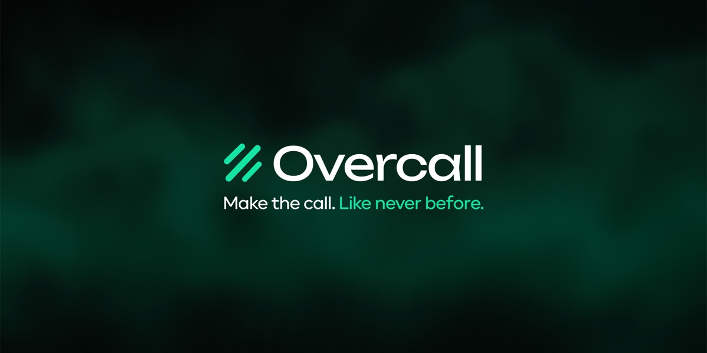
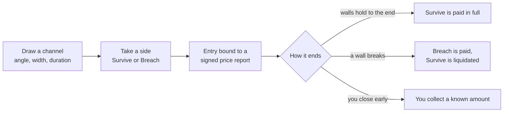

  

  <a href="https://app.overcall.io"><b>App</b></a> ·
  <a href="https://overcall.io"><b>Website</b></a> ·
  <a href="https://docs.overcall.io"><b>Live docs</b></a> ·
  <a href="https://x.com/itsovercall"><b>X</b></a> ·
  <a href="docs/09-contracts.md"><b>Contracts</b></a>

# Overcall documentation

Overcall is a trustless platform for skill-based markets across crypto and stocks, where trading and prediction meet, priced by decentralized oracles and settled onchain. It runs on **Robinhood Chain mainnet** with real $OVER and $USDG.

You trade the **path** of a price, not just its direction. A neutral vault in your position's currency is always your counterparty, your multiplier is the honest inverse of your win probability, and every price, position and payout is a public onchain event.

## At a glance

| | |
| --- | --- |
| **Network** | Robinhood Chain mainnet, an Arbitrum-based L2 (chain ID 4663) |
| **Products** | Channels (draw a channel on a live price and take a side) and Prediction (back or fade another player's live channel) |
| **Markets** | BTC, ETH, BNB, SOL, HYPE, VIRTUAL and CASHCAT live; XRP, DOGE and tokenized stocks coming soon |
| **Prices** | Chainlink Data Streams, signed reports verified onchain |
| **Counterparty** | A neutral vault per position currency, no order book |
| **Position currencies** | $OVER for everyone; $USDG with a stake of 100,000 $OVER or more |
| **Token** | $OVER, [`0x6245Db7f52379bD9757c9DdcE6519768FfaB3a4F`](https://robin.etherscan.io/address/0x6245Db7f52379bD9757c9DdcE6519768FfaB3a4F) |
| **Testnet demo** | The same app on Robinhood Chain Testnet (chain ID 46630) with free test tokens, at [testnet.overcall.io](https://testnet.overcall.io) |

## How a position works

You draw a channel with three controls, the **angle** it leans, the **width** of its walls and the **duration** it runs, then take a side. Those set one number, the probability your channel survives, and each side's multiplier is the honest inverse of its own outcome, final the moment your entry is bound to a signed price report.

Whatever you collect is paid in your position's currency, from that currency's vault. Prediction runs on the same engine: you back someone else's live channel instead of your own. Read more in [Channels](docs/02-channels.md) and [Prediction](docs/04-prediction.md).

## Documentation

| Section | Pages |
| --- | --- |
| **About** | [Vision](docs/01-vision.md) · [Roadmap](docs/14-roadmap.md) |
| **Products** | [Channels](docs/02-channels.md) · [Parameters and markets](docs/03-parameters-and-markets.md) · [Prediction](docs/04-prediction.md) |
| **Protocol** | [Platform engine](docs/05-engine.md) · [Price feeds](docs/06-price-feeds.md) · [Vault](docs/07-vault.md) · [Security](docs/08-security.md) · [Contracts and addresses](docs/09-contracts.md) · [Developers and agents](docs/10-developers.md) |
| **Economy** | [The $OVER token](docs/11-over-token.md) · [Tokenomics](docs/12-tokenomics.md) · [Staking](docs/13-staking.md) |
| **Reference** | [Using the app](docs/15-using-the-app.md) · [FAQ](docs/16-faq.md) · [Glossary](docs/17-glossary.md) |

> [!NOTE]
> These pages follow the live documentation at [docs.overcall.io](https://docs.overcall.io), which also holds the step-by-step guides to the app. Every page here links the live page it comes from.

## Verify it yourself

Nothing about the rules is offchain. Every contract, its live parameters and every position and payout ever settled are public on [robin.etherscan.io](https://robin.etherscan.io). Start from [Contracts and addresses](docs/09-contracts.md).
