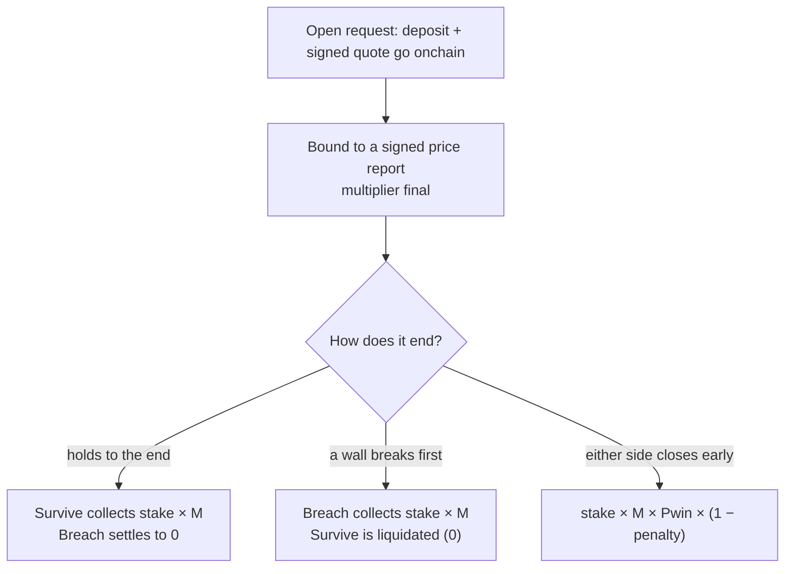

# Channels

Your walls, your rules: the first product on Overcall, and the fastest way to see what the platform does. This page covers what Channels is, how a position opens, and how it closes.

## What Channels is

You draw a channel on a live price and take a side: **Survive** if it holds every wall to the end, or **Breach** if a wall breaks first. Priced by a decentralized oracle, settled onchain, paid from the vault of your position's currency.

You draw an angled band of two walls on the live price of any market, then take a side and open a position in $OVER, or in $USDG if you stake 100,000 $OVER or more. You shape the channel with three controls, the **angle** it leans, the **width** of the walls, and the **duration** it runs. Those set one number, the probability your channel survives, and each side's multiplier is the honest inverse of its own outcome, final the moment your entry is bound to a signed price report.

Then it ends one of three ways: the channel holds to the end, which pays the **Survive** side in full; a wall breaks, which pays the **Breach** side and liquidates Survive; or you close early for a known amount. Whatever you collect is paid in your position's currency, from that currency's vault, and every step is an onchain event anyone can verify. The only difference with [Prediction](04-prediction.md) is whose channel you back: your own here, someone else's live one there.

**That is the whole idea.** To play it, see the [Quick start guide](15-using-the-app.md#quick-start). For the math that sets your multiplier, see [Opening a position](#opening-a-position).

## Opening a position

Three continuous knobs shape every position, the **angle** you lean, the **width** of your walls, and the **duration** you commit. Then you take a side, Survive or Breach, and its multiplier, the honest inverse of that outcome, is final the moment your entry is bound.

You enter at the bound mark: Survive wins if the price holds inside your walls to the end, Breach wins if a wall breaks first.

### The channel you draw

A channel is a band on the live price with four parts: a **center**, a **height** (how far the walls sit from the center), a **slope** (the lean), and a **start** and **end**. The center either follows the line you draw, or is fixed by the entry price of the first position opened on it. The walls track the center as it leans:

**Channel geometry**

```text
center(t) = center · (1 + slope · (t − start))
walls     = center(t) ± center · height / 2
```

You shape all three from the ticket: the angle (slope), the width (height), and the duration.

### Angle, width, duration

Three continuous knobs shape the channel. **Angle** tilts it up or down, your read on the trend. **Width** sets how far the walls sit from the center, measured in [range](03-parameters-and-markets.md#range-the-volatility-unit), the asset's volatility unit. **Duration** is how long it runs. Together they set one number, the probability your channel survives to the end, and that number prices both sides: tighter, steeper and longer are harder to survive, so Survive pays more and Breach pays less.

### Your multiplier: the honest inverse of your side

The operator reads the asset's live volatility and the exact shape you drew and computes **P**, the probability the channel survives to the end. It is the chance a random price path with drift never touches either wall, a standard double-barrier model averaged over the uncertainty in volatility. Each side's multiplier is the honest inverse of its own outcome, less a published spread:

**Multiplier**

```text
Survive: M = (1 − δ) / P
Breach:  M = (1 − δ) / (1 − P)
```

δ is the published spread on each side's odds, the model's buffer. Both are capped by a ceiling, set per currency, that keeps each vault solvent. The platform's income is its published fees, never a hidden edge.

The spread **δ** sits next to the odds, never inside them (see [Parameters and limits](03-parameters-and-markets.md#parameters-and-limits)), and there is no hidden edge: anyone can recompute your multiplier from the signed inputs. The same P prices **both sides** of your channel, so you can take either. A channel exists as an NFT, and its creator earns a royalty whenever a prediction wins on it: 15% of that prediction's profit fee, in $OVER and $USDG. See [Dashboard and metrics](15-using-the-app.md#dashboard-and-metrics).

### Your currency

You open a position in $OVER or, if you stake 100,000 $OVER or more, in $USDG. The currency belongs to the position, not to the channel: your deposit, the fees, the payout and the vault on the other side are all in that currency. The fee percentages, the royalty share and the minimum multiplier are the same in both; the position size, the fixed minimum of the open fee and the multiplier cap are set per currency (see [Parameters and limits](03-parameters-and-markets.md#terms-per-currency)).

### Your entry is bound, not chosen

Opening is a request, not an instant fill. Your deposit and signed quote go onchain, and the position becomes active only when it is **bound** to a signed price report that covers your timestamp. Nobody, neither you nor the operator, picks the entry price: it comes from the report. Your multiplier locks at that moment and nothing about the deal can change afterward.

The **open fee**, the greater of 1% of the deposit and a fixed minimum (20 $OVER, or 0.05 USDG on a $USDG position), is carved out of the deposit at open, win or lose; the rest is your **stake**, the amount every payout formula multiplies. Then you decide how to leave: [Closing a position](#closing-a-position).

## Closing a position

Your multiplier is final when your entry binds onchain. The side you took, and how and when you leave, decide how much of it you collect, and the vault settles you the instant it resolves, unless trading is paused for a review: then a win pays your stake at once and holds the rest for the review.

### The ways out

| Exit | You collect | When |
| --- | --- | --- |
| Your side wins | stake × M | Survive: the channel holds to the end<br>Breach: a wall breaks first |
| Close early | stake × M × Pwin × (1 − penalty) | either side cashes out before it resolves, for a known amount |
| Your side loses | 0 | Survive: a wall is touched, the position is liquidated<br>Breach: the channel holds to the end |
| Win during a pause | your stake now, the rest after the review | trading was paused for a review when your side won: the app shows **In review** until the review pays the rest, or **Rejected** if it does not (see [When trading pauses](07-vault.md#when-trading-pauses)) |
| Payout waiting | your payout, held for you | the token refused the transfer to your address, so the vault keeps the amount for you to withdraw from the dashboard |

Any payout above your stake carries the **profit fee**: 10% of the profit, published beside your odds, never inside them. When the winning position is someone else's, 15% of that fee goes to the channel's creator as a royalty, in your position's currency; the rest is revenue of the vault in that currency. See [Parameters and limits](03-parameters-and-markets.md#parameters-and-limits).

The same channel, three endings: hold to the end and Survive wins, close early for a known amount, or break a wall and Breach wins.



### Hold to the end

If the channel reaches its end without touching a wall, the **Survive** side collects the **full payout**, stake × M, and the Breach side settles to 0. If trading is paused for a review at that moment, Survive gets its stake at once and the rest is held for the review (see [When trading pauses](07-vault.md#when-trading-pauses)). An end-of-channel settlement needs **no price report at all**, so it can never be blocked by an oracle outage: no report means no breach can be proven, which favors Survive. This is the never-stuck escape (see [Platform engine](05-engine.md)).

### Close early, mark-to-market

Change your mind at any second and cash out for a known amount. An early close is valued at your position's **current win probability**, then reduced by a small early-close penalty (5%):

**Early close**

```text
value  = stake × M × Pwin(now)
payout = value × (1 − penalty)
```

Pwin is priced at the request moment, using the volatility your position was opened with. The terms of the deal never change retroactively.

For a Survive position Pwin is high while the price sits centered, and falls as it drifts toward a wall; for a Breach position it is the mirror, rising as the price closes in on a wall. The request to close is **irreversible**, and it settles by the close price and probability at that moment. If the price is already outside the channel when you request, that is a breach, not a close. If trading is paused for a review, the close payout up to your stake is paid at once and any gain above it waits for the review (see [When trading pauses](07-vault.md#when-trading-pauses)).

### Touch a wall, and refunds

A wall touch resolves the whole channel at that instant: the **Breach** side collects its full payout, stake × M, and the **Survive** side is **liquidated** (0). If trading is paused for a review at that moment, Breach gets its stake at once and the rest is held for the review (see [When trading pauses](07-vault.md#when-trading-pauses)). The breach is proven, not decided: the operator submits the signed price report that crossed the wall and the contract verifies its signature onchain, so no breach can be fabricated. One proof settles every position and prediction on the channel, whichever side each took.

Cancellations and refunds (an entry bound after a breach, a rule cancellation, or a settlement window that lapsed) return your **deposit minus the fixed portion of the open fee** (20 $OVER, or 0.05 USDG on a $USDG position): that fixed portion covers the operator's gas; everything else comes back.

> [!IMPORTANT]
> **A wall is a real liquidation for Survive.** One touch ends a Survive position at 0, like a futures liquidation, and pays the Breach side in full at the same moment. That is the tension: tighter walls pay Survive more but leave less room to be wrong, and that same touch is exactly what Breach is paid to call.

<sub>Source: [docs.overcall.io/channels](https://docs.overcall.io/channels), [docs.overcall.io/channel](https://docs.overcall.io/channel), [docs.overcall.io/exit](https://docs.overcall.io/exit)</sub>

---

[← Vision](01-vision.md) · [Contents](../README.md#documentation) · [Parameters and markets →](03-parameters-and-markets.md)
