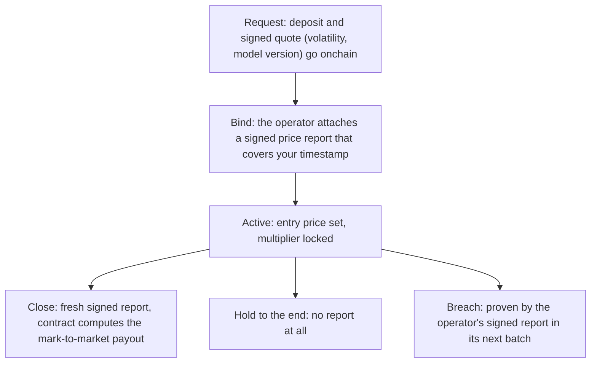

# Platform engine

Underneath every Overcall product is one engine: onchain rails where positions and prices both live on the chain, a neutral vault in each currency as your counterparty, and a payout that is the honest inverse of your win probability. [Channels](02-channels.md) is the first product on it; everything we ship next plugs into the same three pieces.

## The three pieces

| Piece | What it means |
| --- | --- |
| **Onchain rails** Position and price, both onchain | Every position, close and payout is an onchain event anyone can replay, and the price is a decentralized oracle report, not a number we choose. Nothing sits behind a curtain. |
| **Counterparty** A neutral vault | The vault of your position's currency takes the other side of every position and reserves every payout before the position opens, so any market the oracle can price can exist. Details in [Vault architecture](07-vault.md#vault-architecture). |
| **Odds** Priced by probability | One survival probability prices both sides of a channel. Each multiplier is the honest inverse of its own outcome, locked at bind and recomputable by anyone. |

## Winnings priced by probability, in the open

Odds are where most platforms bury their edge. Overcall prices a position from one number, the probability it wins, read from live volatility and the shape drawn. The multiplier is the honest inverse of that probability, less a published **spread** that sits beside the odds and never inside them. A **ceiling**, set per currency, caps the multiplier so each vault stays solvent. There is no house edge hidden in the odds: anyone can recompute a multiplier from the signed inputs. On a normal book you learn the real odds after you lose; here you see them first. The same probability also prices a channel's two-sided [prediction market](04-prediction.md).

## Request, bind, settle

Opening is a request: your deposit and a signed quote (the volatility and the model version) go onchain. A $USDG request also carries an entry permit, a short-lived signature the operator gives wallets with 100,000 $OVER or more staked. The position becomes active only when the operator **binds** it to a signed price report that covers your timestamp, which sets your entry price and locks your multiplier. Nobody, neither you nor the operator, chooses the entry. From there the price is read only against the levels fixed at bind. A close submits a fresh signed report and the contract computes your mark-to-market payout; holding to the end needs **no report at all**, so an oracle outage can never trap funds. A breach is proven by the operator's signed report in its next batch, so the vault is always made whole.

Because every input is either signed or onchain, any result is **reproducible**. The model's parameters are pinned by a hash in an onchain registry, so anyone can download them and recompute a multiplier from the quote, the report and the shape, and get the exact number the contract used.

> [!NOTE]
> **Volatility only sizes, it never decides.** Each asset's volatility (range) sizes the channel to its market and arrives inside the signed quote. It is bounded and never decides who wins; the price against the levels you set does. Everything else is either your choice or a signed oracle report.

The price layer, the decentralized oracle that settles everything, is covered in [Price feeds](06-price-feeds.md).

Source: [docs.overcall.io/engine](https://docs.overcall.io/engine)

---

[← Prediction](04-prediction.md) · [Contents](../README.md#documentation) · [Price feeds →](06-price-feeds.md)
