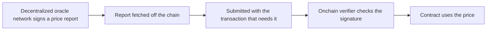

# Price feeds

Every outcome on Overcall is decided by a decentralized price feed, Chainlink Data Streams, not by us. No single venue sets your price, so no one can paint a wick or hunt a stop to take you out.

## Why this feed

| Property | What it means |
| --- | --- |
| **Decentralized** No single-venue manipulation | Reports are aggregated across venues and signed by a decentralized oracle network, using multi-source reference prices rather than any one exchange's book. There is no single wick that can stop you out. |
| **Sub-second** Fast enough to settle live | Reports are high-frequency and low-latency, so a close is marked to the market you are actually watching, not a slow, averaged feed. |

## A pull oracle, verified onchain

Data Streams is a **pull** oracle. Signed price reports are fetched off the chain and submitted with the transaction that needs them, and an onchain verifier checks the oracle network's signature before the contract uses the number. We relay reports to your browser for convenience, but we cannot alter them: they are oracle-signed. We never produce the price; we only read it.

> [!NOTE]
> **No report, no problem.** A channel that reaches its end settles with **no price report at all**, so a feed outage can never trap your funds or knock you out. See [Platform engine](05-engine.md#request-bind-settle).

## Mainnet feeds

Each market on Robinhood Chain mainnet is registered onchain with its Data Streams feed ID, so you can check which feed settles it. Every report is checked by the Chainlink verifier on Robinhood Chain mainnet, [0xcE73…36E7](https://robin.etherscan.io/address/0xcE73c8ad08CBDEaCa6078BF0627C8fe0a9a536E7), before the contract uses its price.

| Market | Feed ID |
| --- | --- |
| BTC/USD | `0x00039d9e45394f473ab1f050a1b963e6b05351e52d71e507509ada0c95ed75b8` |
| ETH/USD | `0x000362205e10b3a147d02792eccee483dca6c7b44ecce7012cb8c6e0b68b3ae9` |
| BNB/USD | `0x000335fd3f3ffa06cfd9297b97367f77145d7a5f132e84c736cc471dd98621fe` |
| SOL/USD | `0x0003b778d3f6b2ac4991302b89cb313f99a42467d6c9c5f96f57c29c0d2bc24f` |
| HYPE/USD | `0x0003d34539af562867c3cb309b59efccf40e74b404fb415eeb7699d61322aed9` |
| VIRTUAL/USD | `0x000385c20fe1d88dfbf4629f188bf03ee004a034c844ec31dbf57d197adade89` |

Source: [docs.overcall.io/feeds](https://docs.overcall.io/feeds)

---

[← Platform engine](05-engine.md) · [Contents](../README.md#documentation) · [Vault →](07-vault.md)
