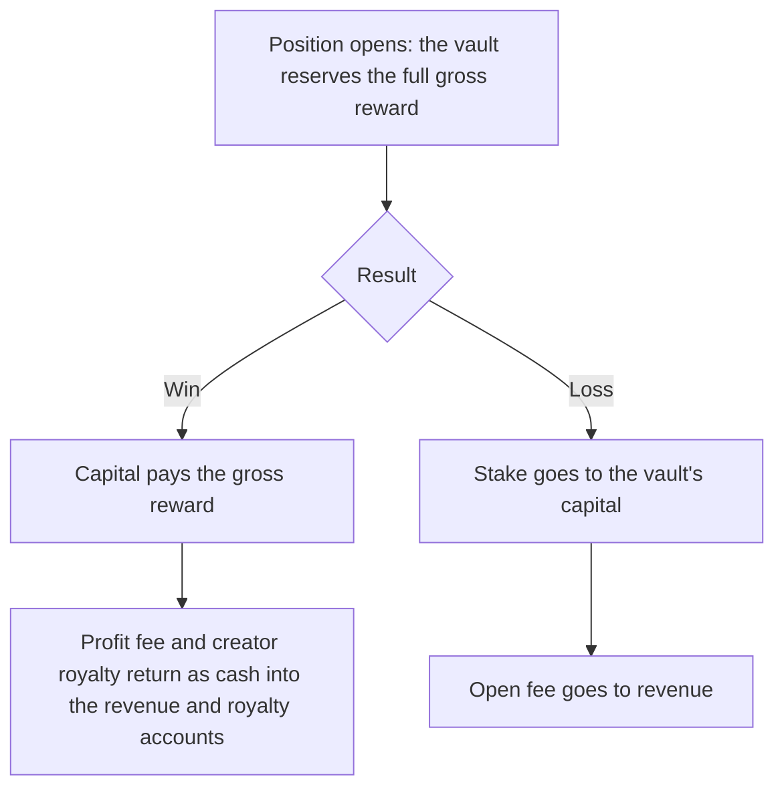

# Vault

Every position on Overcall trades against the Settlement Vault of its currency. This page covers how the vaults work and what happens when trading pauses for a review.

## Vault architecture

At the center of Overcall sit the Settlement Vaults, one per currency: one for $OVER and one for $USDG. Each is the counterparty to every position in its currency, on every market, and reserves every payout before the position opens. While trading is paused for a review, new positions wait. The $OVER vault is built to scale in proportion with $OVER, both ways.

You do not trade against a house that profits when you lose. You trade against a **neutral, onchain vault** that takes the other side of every position and pays every winner automatically. There is no order book to bootstrap: if the oracle can price a market, the vault can take it, at the live mark, for a known amount, up to the free capital of that currency's vault. Its only margin is a published fee beside your odds, never a number baked into them. Anyone can read the rules, and anyone can recompute the result.

Every market, position, result and payout is a public onchain event: the vault pays, collects and balances in the open.

### One vault for each currency

Each currency has its own vault, funded with its own capital and keeping its own reserves, revenue and royalties. A position's deposit, fees and payout stay in the currency it was opened in, and a win is paid only from the vault of that currency.

### Scales with the token, both ways

A counterparty that can lose is only as strong as its balance sheet. The $OVER vault draws its capital from the **Platform vault liquidity** allocation of 150M $OVER (see [Tokenomics](12-tokenomics.md)): 50M is in the vault, and 100M is in the $OVER reserve, [0x437b…5065](https://robin.etherscan.io/address/0x437bCF676D11FFE5542BfAa842b560e431285065), kept apart for security and for expanding to other chains. Both are public onchain (see [Contracts and addresses](09-contracts.md#addresses)). Because every $OVER position pays out in $OVER, a higher token price means a deeper $OVER vault, which clears bigger max payouts and more volume, which lifts the token again. Lost positions return to the vault's capital automatically, and platform fees route back into vault and trading liquidity, so **real revenue becomes deeper payouts**. You are not trading against a fixed pot a good day can drain, but a counterparty that gets stronger exactly as the platform does. The $USDG vault holds $USDG, so its depth does not move with $OVER: it is funded with its own capital and grows as lost $USDG positions return to it. Part of the fees from $USDG positions goes to $OVER buybacks.

**Sustainable, not a subsidy.** The published fee is a small, transparent edge on every position. Over volume it keeps each vault net positive, so growth funds itself instead of draining a treasury, and no inflationary emissions prop it up.

### Solvency is enforced, not promised

The vault is deliberately **loss-bearing**: over any short window, players can win more than they stake. It stays solvent by construction, not by discretion:

- The odds are the honest inverse of probability, so aggressive positions are negative on average and the neutral edge is the published fee.
- A per-position cap (the multiplier **ceiling**, set per currency) and full reserving, with every position's maximum reward reserved from the capital of its own currency's vault, bound how much each vault can owe at once, so no single win can sink it.
- **A daily loss limit** on each vault, a share of its capital (5% for $OVER, 50% for $USDG) that refills over a day, caps how fast it can shrink: a win larger than what is left pauses trading in both currencies and is held for review (see [When trading pauses](#when-trading-pauses)).
- Every one of these limits is onchain and public. You can read what each vault can owe, and recompute it.

This is the same shape as a perp DEX's LP pool: a real counterparty, sized by rules anyone can read, not a house that sets your price.

### Pauses and reviews

Each vault's **daily loss limit** is 5% of its capital for $OVER and 50% for $USDG, refilled evenly over a day and with every lost position. A single win larger than what is left pauses trading on the whole platform, in both currencies, for a review: new positions wait, open positions keep running, and a win pays your stake at once and the rest once the review approves it. What happens to each kind of position, and how trading resumes, is in [When trading pauses](#when-trading-pauses).

### Cash-model settlement

The vault reserves the **full gross reward** for every open position. On a win, capital pays that gross amount, and the profit fee and the channel creator's royalty return as cash into the revenue and royalty accounts; on a loss, the stake goes to the vault's capital and the open fee to revenue. So the books balance exactly on every settlement, in each currency: what you deposit plus what the vault adds always equals what is paid to you, to revenue, to the creator and back to the vault's capital, to the smallest unit. Nothing is netted out of sight, each settlement is a public identity you can check (the formula is in [Developers and agents](10-developers.md#settlement-identity)).

25% of the profit fees from $OVER positions go to $OVER stakers (see [Staking](13-staking.md)).

## When trading pauses

Trading on Overcall can pause for a review. While it is paused, new positions wait, open positions keep running, and a win pays your stake at once and the rest once the review approves it.

### Why trading pauses

Each currency has its own vault (see [Vault architecture](#vault-architecture)), and each vault has a **daily loss limit**: how much it can pay out in winnings over a day. It is 5% of the vault's capital for $OVER and 50% for $USDG. It refills evenly over 24 hours and with every losing position, so a busy day where wins and losses even out does not reach it. The dashboard shows what is left as **Loss limit left**.

If a win would pay out more than what is left, trading pauses for a review. One pause covers the whole platform, in both currencies: a limit reached in either vault is treated as a sign that something may be wrong, so everything waits until it has been checked. Trading can also be paused by hand, under the same rules.

> [!IMPORTANT]
> **Your stake is paid at once.** On a win during a pause, only the part above your stake (your position less the open fee) waits for the review.

### What happens while trading is paused

| Situation | What happens |
| --- | --- |
| Opening a position or drawing a channel | Refused until trading resumes; the ticket shows **Trading paused** |
| An open position | Keeps running to its end, as usual |
| A losing position | Settles as usual |
| A cancelled or refunded position | Settles as usual |
| A winning position | Your stake is paid at once; the rest is held for the review and the app shows **In review** |
| Closing early | Still allowed. A close worth up to your stake is paid in full at once; above your stake, the stake is paid at once and the rest is held for the review. A close cannot be undone, so the app says this beside **Close now** while trading is paused |
| A channel's royalty | Can be claimed once every held win on the channel is decided |

### The review

- **Approved.** The rest of the win is paid exactly like a normal win, less the profit fee. Before paying, the result is checked against the channel again.
- **Rejected.** You keep the stake that was already paid, and the rest goes back to the vault. The app shows **Rejected**.
- **Final and onchain.** Each decision is a public transaction, and it cannot be reversed.

### How trading resumes

The Overcall team checks what reached the limit and decides every held win: approved, it pays the rest of the win; rejected, you keep your stake. The normal way back is to resume once every held win is decided, and the contracts refuse it before that. For an urgent case the admin (the role in the contracts that can resume trading) can also force trading back on with wins still held: those stay **In review** and are decided afterwards. Resuming does not reset the loss limit: it keeps refilling over time and with losing positions.

### Review mode

A single currency can also be put in **review mode**, its daily loss limit set to 0. New channels and positions in that currency are then refused (the app says the currency is not taking new positions), while positions opened before keep running until they win or lose. Their wins are held for a review the same way: **In review** means the win is waiting for its decision.

Source: [docs.overcall.io/vault](https://docs.overcall.io/vault), [docs.overcall.io/pauses](https://docs.overcall.io/pauses)

---

[← Price feeds](06-price-feeds.md) · [Contents](../README.md#documentation) · [Security →](08-security.md)
