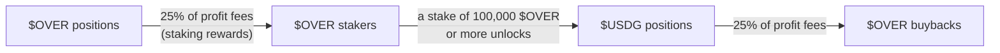

# The $OVER token

$OVER is the core asset of the platform: you need it to take a position. Open positions in $OVER, or stake 100,000 $OVER or more to unlock $USDG positions.

## The token

The platform and the token are not two things that share a name: they are one system, and they grow together by design.

That design is a loop. More $OVER volume deepens the $OVER vault, a deeper vault clears bigger payouts and more volume, and platform fees route back into liquidity, so real revenue becomes deeper payouts. In an $OVER position you play in $OVER and win $OVER, and the vault that settles those wins holds $OVER too. 25% of the profit fees from $OVER positions go to staking rewards, and 25% of the profit fees from $USDG positions go to $OVER buybacks.

### The flywheel

| Part | Role in the loop |
| --- | --- |
| **Positions** | Every position players open is volume through the engine. |
| **Fees** | A transparent fee on that volume, the platform's real revenue. |
| **Vault** | Fees deepen the neutral counterparty that settles every win. |
| **Liquidity** | Fees also feed $OVER trading liquidity, tightening the market. |

Fees deepen the vault and trading liquidity; the token and the platform lift each other.

**The loop:** more volume → deeper vault → higher payout capacity → greater holder rewards → more volume

The loop is aligned by the vault's transparent fee, which keeps it net positive over volume, so growth funds itself.

**Sustainable, not a subsidy.** Over volume the published fee keeps each vault net positive, so the loop funds itself, with no treasury drain and no inflationary emissions behind it. See [Vault architecture](07-vault.md#vault-architecture) for how the counterparty is built, and [Utility](#utility) for what the token does.

### Launch

$OVER launched on the **Virtuals** launchpad: liquid and community-owned from the token generation event, and the core financial asset of the ecosystem from day one. Channels is the first product, not the last, and future products plug straight into the same rails: one settlement engine, one identity, an economy built around $OVER.

The full supply and allocation, with every cliff and vesting schedule, are published on the [Tokenomics](12-tokenomics.md) page.

## Utility

What $OVER actually does: it is the key to every position, the collateral behind $OVER positions, and a stake that earns a share of platform fees and unlocks $USDG positions (from 100,000 $OVER). Three jobs, all reinforcing the same economy.

### Play: the key to every position

$OVER positions open and pay out in $OVER, from the $OVER vault, and $USDG positions are unlocked by staking 100,000 $OVER or more. Channel royalties are claimed in $OVER too. The more Overcall is played, the more $OVER has to be held, staked and moved, so demand scales with real usage, not a narrative.

### Back: collateral in the vault

The $OVER vault that pays $OVER wins holds $OVER, so the token directly backs settlement. A stronger token means deeper payouts. See [Vault architecture](07-vault.md#vault-architecture).

### Stake: share in fees, unlock $USDG

Stakers earn a share of platform fees: 25% of the profit fees from $OVER positions go to them. A stake of 100,000 $OVER or more also unlocks $USDG positions. See [Staking](13-staking.md).

### A demand engine and a supply sink

The same design pushes demand up and free float down. Usage forces $OVER to be held and moved, while $OVER held in the vault and $OVER staked are out of circulation. $USDG activity adds $OVER demand too, because $USDG positions require 100,000 $OVER or more staked. 25% of the profit fees from $USDG positions go to $OVER buybacks, and 25% of the profit fees from $OVER positions go to staking rewards. Real activity raises demand while the circulating supply trends lower.

Source: [docs.overcall.io/over](https://docs.overcall.io/over), [docs.overcall.io/utility](https://docs.overcall.io/utility)

---

[← Developers and agents](10-developers.md) · [Contents](../README.md#documentation) · [Tokenomics →](12-tokenomics.md)
